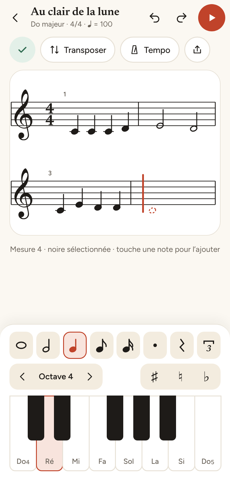
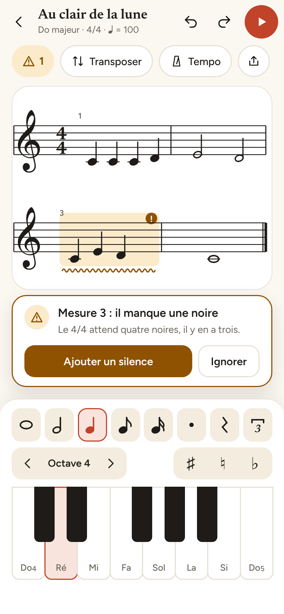
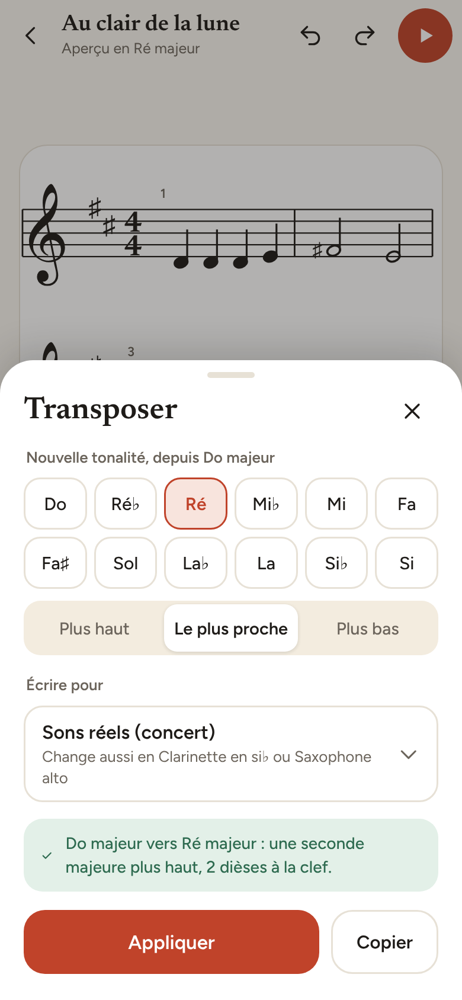

# Fredonne

Appli Android libre pour écrire une mélodie sur son téléphone et la transposer dans une autre tonalité. Tout reste sur l'appareil.

> Projet en démarrage : le moteur musical est écrit et testé, l'interface existe en maquettes. L'application n'est pas encore utilisable.

  
  
  

<a href="docs/maquettes/README.md">Voir les douze écrans</a>

## Principes

- Gratuite et libre (MPL-2.0)
- Aucune permission Internet, aucun traceur, aucun compte
- Hors ligne, les partitions restent sur le téléphone
- Formats ouverts : MusicXML, MIDI, ABC

## Première version (prévue)

- Saisie d'une mélodie à une voix : curseur d'insertion, rangée de durées, mini clavier de piano, correction par glissement
- Lecture par le synthétiseur MIDI du téléphone, avec retour sonore à chaque note
- Transposition vers une autre tonalité ou par intervalle, avec les instruments transpositeurs (Si bémol, Mi bémol, Fa)
- Vérificateur en toile de fond : durées de chaque mesure, tessiture de l'instrument, orthographe des altérations (il souligne, il ne bloque pas)
- Export PDF sans filigrane, partitions en nombre illimité, historique local
- Import et export de fichiers MusicXML et MIDI, par le sélecteur de fichiers Android (sans autorisation de stockage)
- Annuler et rétablir sans limite, mode paysage, zoom

## Hors périmètre pour l'instant

Modulation métrique et rapports de tempo (prévus pour la version 2, pour la musique contemporaine), scan de partitions par photo, partitions d'orchestre, deuxième portée, accords, paroles. Le scan demande un modèle de reconnaissance embarqué ou un serveur : il ne sera étudié que s'il respecte les principes ci-dessus.

## Ce qu'on utilise

| Domaine | Choix | État |
|---|---|---|
| Langage | Kotlin 2.0, pour tout le code | En place |
| Moteur musical | Kotlin pur, sans dépendance Android (`core:music`), JVM 17 | En place |
| Durées et tempos | Fractions exactes en entiers 64 bits, jamais de décimaux : pas d'erreur d'arrondi dans les mesures ni dans les rapports de tempo | En place |
| Notation et transposition | Hauteurs avec orthographe (do dièse n'est pas ré bémol), intervalles par degrés et demi-tons, armures | En place |
| Instruments | Seize instruments avec leur transposition et leur tessiture courante (clarinette, saxophones, cor, voix, guitare...) | En place |
| Vérificateur | Durées de chaque mesure (triolets, quintolets, anacrouse), tessiture | En place |
| Tests | `kotlin.test` et JUnit 5, lancés par GitHub Actions à chaque envoi | En place |
| Build | Gradle (Kotlin DSL) | En place |
| Interface | Jetpack Compose | Prévu |
| Portée | Dessinée dans Compose avec la police Bravura (SMuFL, licence SIL OFL) | Prévu |
| Son | Synthétiseur MIDI d'Android, échantillons libres de droits à l'étude | Prévu |
| Formats | MusicXML, MIDI, PDF | Prévu |

Choix de fond : peu de dépendances, aucune bibliothèque publicitaire ou de statistiques, aucune permission Internet, fichiers ouverts par le sélecteur d'Android sans permission de stockage. Le moteur musical est séparé de l'interface pour pouvoir être testé sans téléphone.

## Architecture prévue

| Module | Rôle |
|---|---|
| `core:music` | Modèle musical, transposition, lecture et écriture MusicXML et MIDI. Kotlin pur, couvert par des tests |
| `core:engraving` | Mise en page de la portée à partir du modèle |
| `app` | Interface Jetpack Compose, saisie, lecture sonore |

Détails et choix de conception dans [`docs/conception.md`](docs/conception.md).

## Contribuer

Les idées, les retours d'utilisation et les corrections sont bienvenus dans les tickets. Contact : pilmil.studio@proton.me

## Licence

[MPL-2.0](LICENSE). Une application de Pilmil Studio.

## Note sur la fabrication

Une partie du code et de la documentation de ce projet est écrite avec l'aide de Claude (Anthropic), sous la direction et la relecture de l'auteur.
