# Maquettes de Fredonne

Propositions de design pour l'application. Ce sont des **maquettes**, pas l'appli : elles servent à discuter de l'interface avant d'écrire le rendu et la saisie.

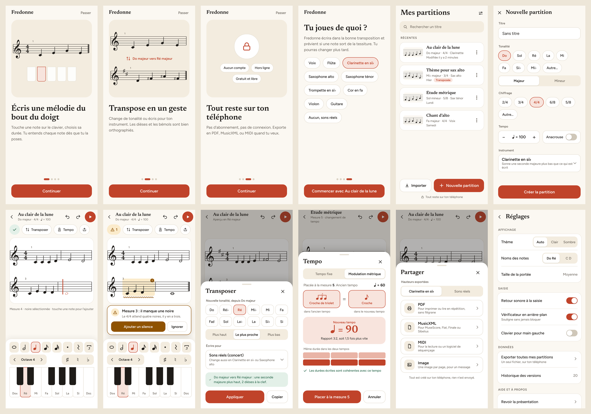

## Écrans

| | | | |
|---|---|---|---|
| 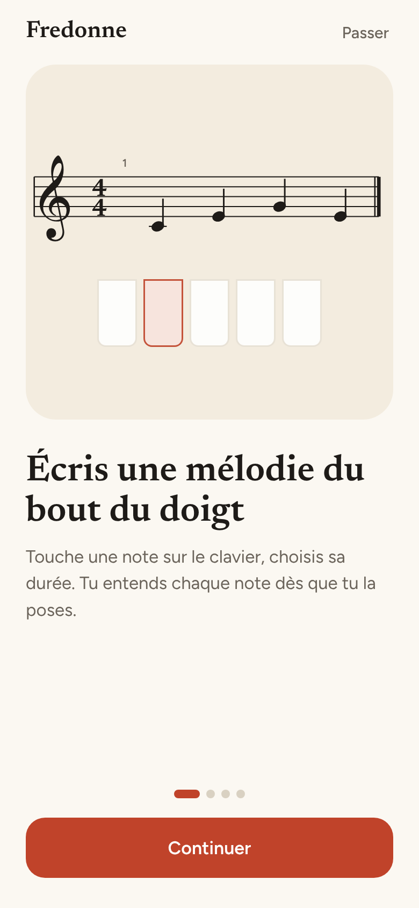 | 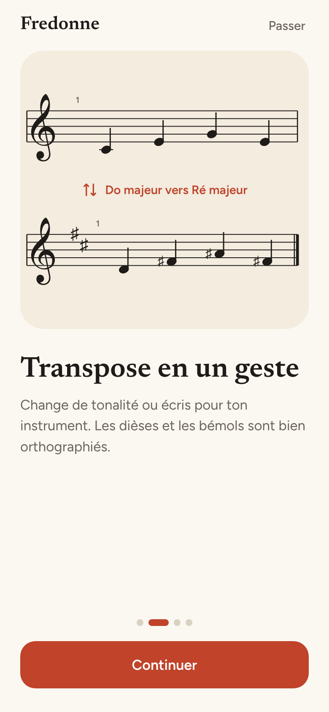 | 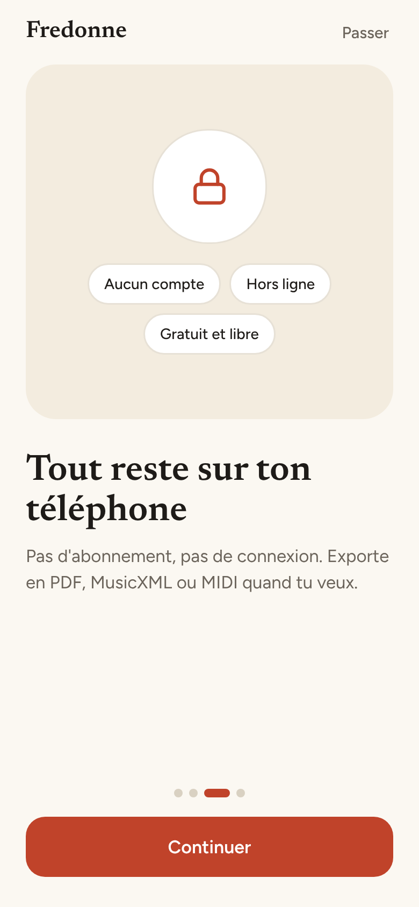 | 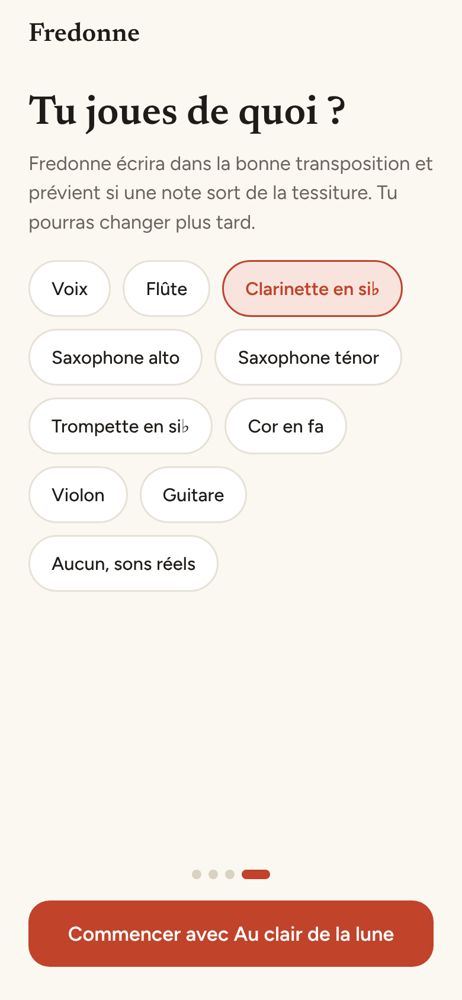 |
| Présentation 1 : écrire | Présentation 2 : transposer | Présentation 3 : vie privée | Présentation 4 : instrument |
| 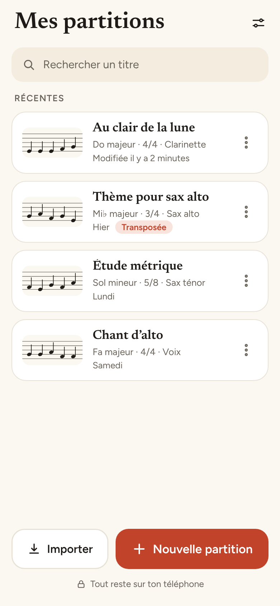 | 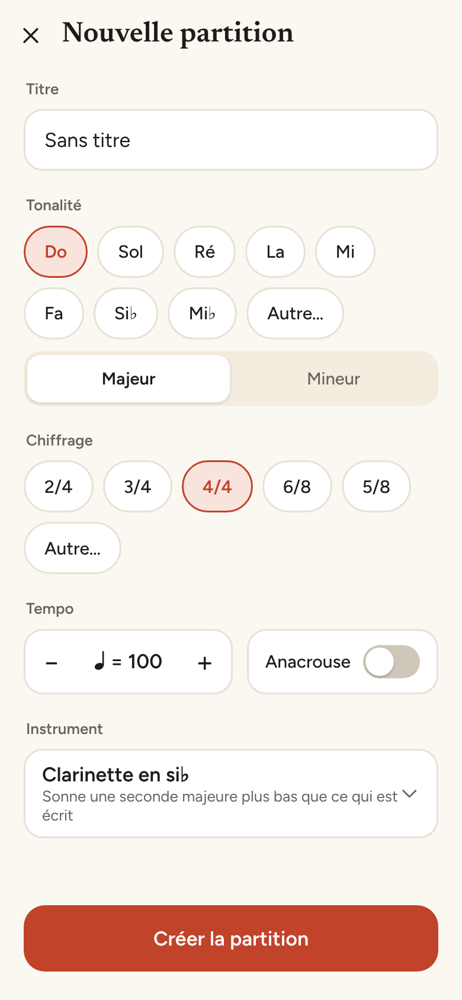 | 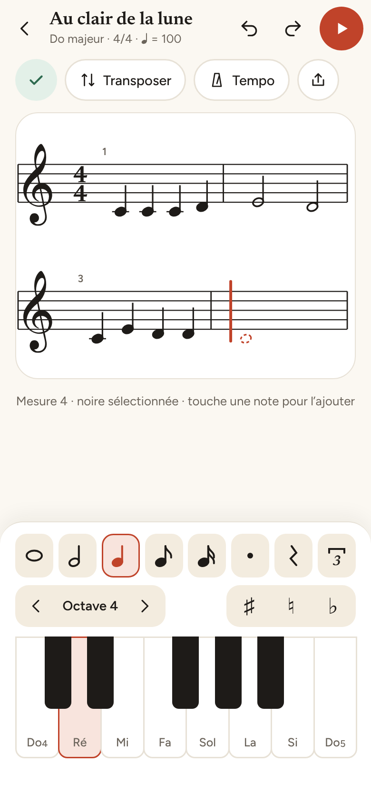 | 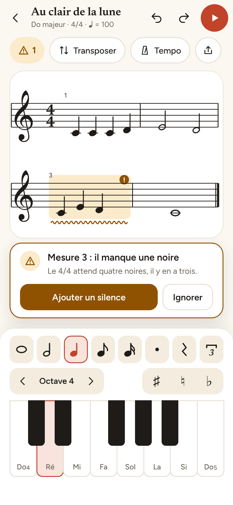 |
| Accueil | Nouvelle partition | Éditeur | Vérificateur |
| 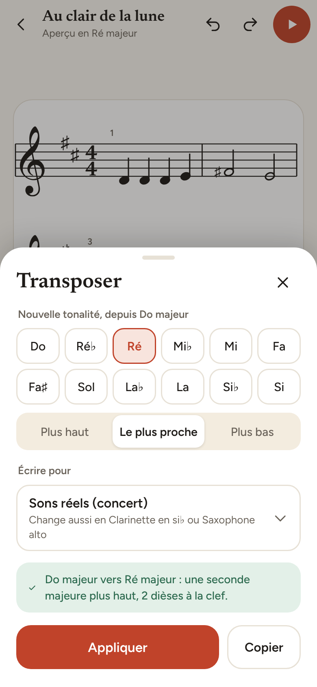 | 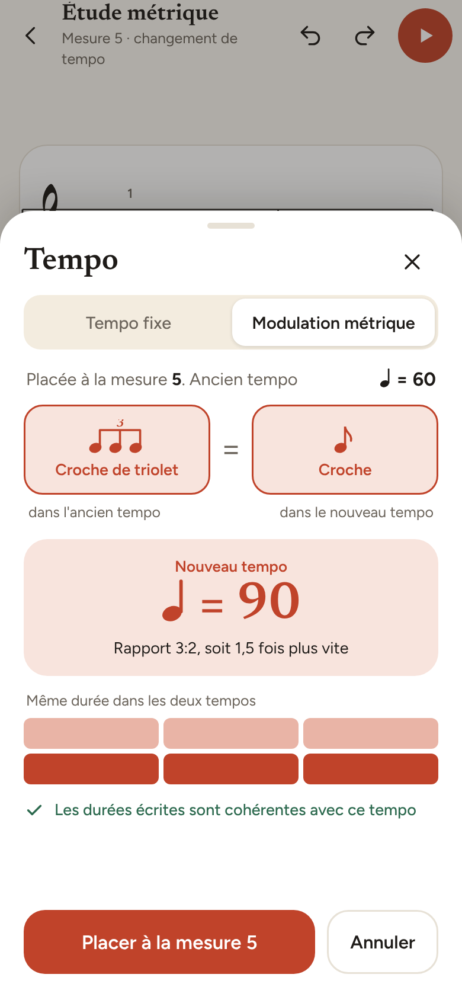 | 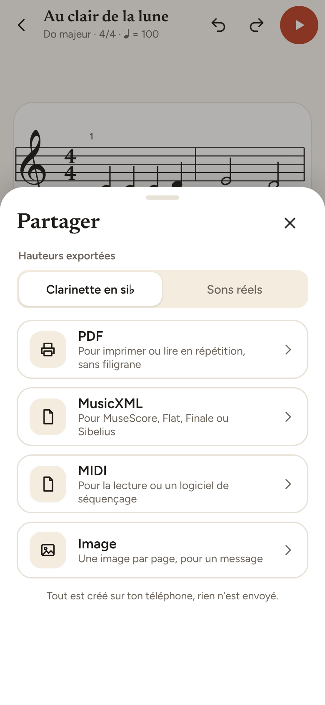 | 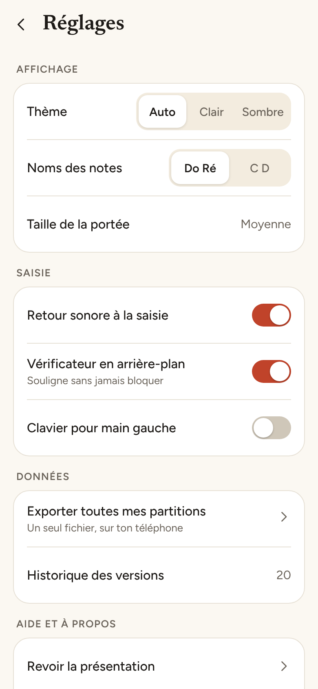 |
| Transposer | Tempo et modulation métrique | Partager | Réglages |

## Ce qu'elles montrent

- **Saisie au pouce :** curseur d'insertion sur la portée, rangée de durées (ronde à double croche, point, silence, triolet), clavier de piano en notes françaises avec choix de l'octave. Chaque note posée est jouée.
- **Vérificateur en arrière-plan :** une mesure incomplète ou trop longue est soulignée, avec une proposition de correction. Il souligne, il ne bloque jamais, et ne signale pas la mesure en cours d'écriture.
- **Transposition :** douze tonalités, sens (plus haut, plus bas, le plus proche), écriture pour un instrument transpositeur, aperçu de l'armure.
- **Modulation métrique :** l'utilisateur indique l'équivalence entre une valeur de l'ancien tempo et une du nouveau, Fredonne calcule le tempo et vérifie les durées.
- **Partage :** PDF sans filigrane, MusicXML, MIDI, image, au choix en notation pour l'instrument ou en sons réels.
- **Vie privée :** aucun compte, aucune connexion, rappelée en une ligne au premier lancement et détaillée dans les réglages.

## Premier lancement : décision du 12 novembre 2026

Les maquettes 01 à 03 (écrire, transposer, vie privée) ne seront pas des écrans de l'appli. Trois écrans de présentation avant de pouvoir poser une note, c'est de la friction sans contrepartie : ils ne règlent rien et ne demandent rien.

Au premier lancement, l'appli montre un seul écran, puis la partition :

1. **Le choix de l'instrument** (maquette 04), parce qu'il change réellement l'appli : notation, tessiture, transposition proposée. Il se passe d'un appui (« Plus tard », réglage par défaut : sons réels) et se modifie ensuite dans les réglages. Une ligne sous le choix rappelle l'essentiel de la vie privée : aucun compte, aucune connexion.
2. **Une partition vide, curseur posé sur la première mesure**, avec une courte aide à la première saisie (« touche une note pour l'ajouter », déjà visible sous la portée dans la maquette 07). On apprend en écrivant.

Le contenu des maquettes 01 à 03 n'est pas perdu : il sert pour la fiche Google Play et le site, où la personne n'a pas encore décidé d'installer.

Reste à dessiner : la maquette 04 avec son bouton « Plus tard » et sa ligne sur la vie privée, et l'aide à la première saisie.

## Direction visuelle

- Papier crème, encre sombre, une seule couleur d'accent (terracotta).
- Titres en Newsreader, interface en Figtree, portée en Bravura (polices libres, licence SIL OFL).
- Cibles tactiles de 44 px au minimum, texte contrasté (au moins 4,5:1).

## Pas encore dessiné

Mode sombre, mode paysage, tablette, état vide de l'accueil, aide à la première saisie.
